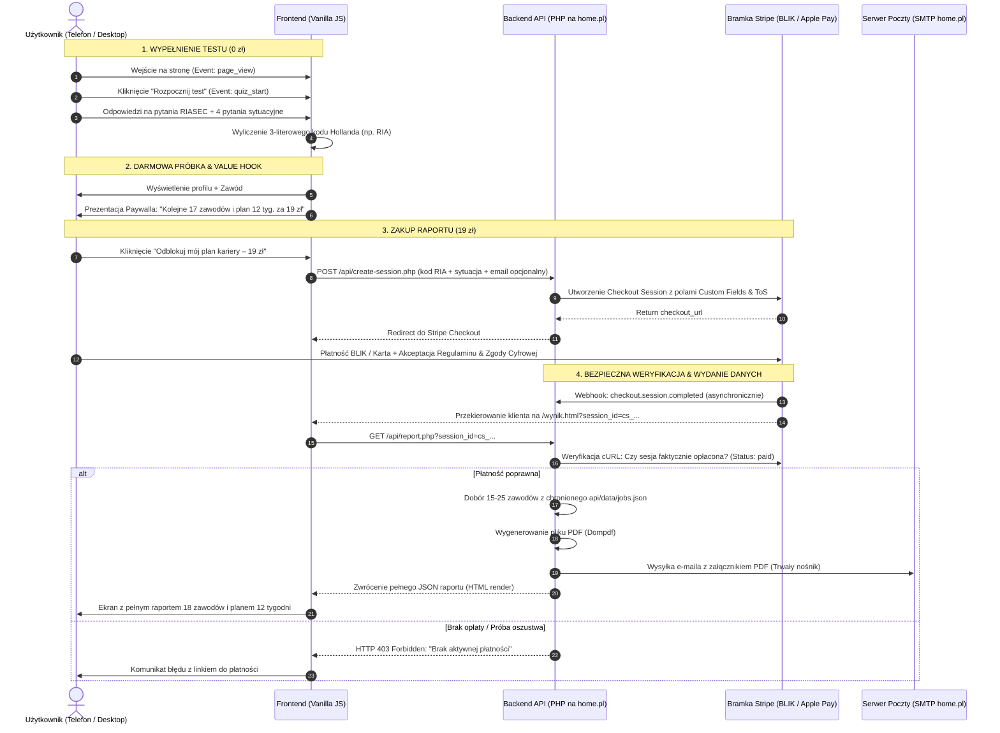
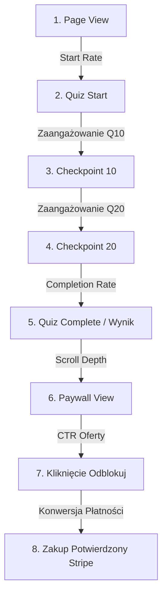

# 📐 SPECYFIKACJA WDROŻENIOWA — Architektura i Dokumentacja Techniczna CheckYourself

> **Typ dokumentu:** Technical Design Document (TDD) / Architecture Blueprint / RFC  
> **Status:** Zaakceptowany do realizacji  
> **Wersja:** 2.0 (Listopad 2026)  
> **Autorzy:** Jakub Madejski, Wojtek (@Wojtek — audyt z 8.11.2026), Antigravity AI  
> **Środowisko docelowe:** Hosting Apache / PHP 8.x (home.pl) + Vanilla JS / CSS Mobile-First + Stripe API  
> **Główny cel:** Wdrożenie szczelnego, bezpiecznego i wysoce konwertującego lejka sprzedaży raportów kariery (19–29 zł) oraz pakietów konsultacji (99–149 zł).

---

## 📑 Spis Treści

1. [Architektura Systemu i Diagram Przepływu Danych](#1-architektura-systemu-i-diagram-przepływu-danych)
2. [Bezpieczeństwo i Uszczelnienie Paywalla (Protokół Tokenowy)](#2-bezpieczeństwo-i-uszczelnienie-paywalla-protokół-tokenowy)
3. [Specyfikacja API i Endpointów Backendowych (PHP 8.x)](#3-specyfikacja-api-i-endpointów-backendowych-php-8x)
4. [Algorytm Scoringu RIASEC (Kod 3-literowy + Pytania Sytuacyjne)](#4-algorytm-scoringu-riasec-kod-3-literowy--pytania-sytuacyjne)
5. [Model Bazy Danych i Schemat Zawodów (150 Pozycji)](#5-model-bazy-danych-i-schemat-zawodów-150-pozycji)
6. [Darmowa Próbka (Freemium Value Hook) vs Płatny Raport](#6-darmowa-próbka-freemium-value-hook-vs-płatny-raport)
7. [Architektura Generowania i Wysyłki PDF (Trwały Nośnik)](#7-architektura-generowania-i-wysyłki-pdf-trwały-nośnik)
8. [System Analityki Lejka 7 Kroków (Zero-Cookie Telemetry)](#8-system-analityki-lejka-7-kroków-zero-cookie-telemetry)
9. [UI/UX, Mobile-First i Generator Instagram Stories (1080×1920)](#9-uiux-mobile-first-i-generator-instagram-stories-10801920)
10. [Copywriting, Budowa Zaufania i Wymogi Prawne (Omnibus, UOKiK, Stripe)](#10-copywriting-budowa-zaufania-i-wymogi-prawne)
11. [Matryca Testów i Bramki Jakościowe (Quality Gates)](#11-matryca-testów-i-bramki-jakościowe)

---

## 1. Architektura Systemu i Diagram Przepływu Danych

Aplikacja opiera się na architekturze hybrydowej:
- **Frontend (Klient):** Czysty, bezframeworkowy HTML5, CSS3 (Liquid Glass / Modern Technical) i Vanilla JavaScript. Odpowiada za błyskawiczny rendering quizu (~0.1s czasu odpowiedzi, 16 KB wagi strony), obsługę interakcji, zapis stanu w `sessionStorage` oraz prezentację darmowej próbki.
- **Backend (Serwer home.pl):** Lekkie, modułowe skrypty w PHP 8.x bez ciężkich frameworków MVC. Odpowiadają za chronioną bazę zawodów, autoryzację płatności Stripe, generowanie PDF przez Dompdf, telemetryczny pomiar bez cookies oraz wysyłkę e-maili przez SMTP.



---

## 2. Bezpieczeństwo i Uszczelnienie Paywalla (Protokół Tokenowy)

### 2.1 Likwidacja Furtek (Backdoorów)
W obecnym kodzie zidentyfikowano trzy krytyczne podatności, które zostają bezwzględnie zlikwidowane:
1. **Funkcja deweloperska w DOM:** Usunięcie bloku w `js/app.js`:
   ```javascript
   // DO USUNIĘCIA:
   window.toggleTestUnlock = function() { ... }
   // i przycisku: <button onclick="toggleTestUnlock()">🧪 [Podgląd dla testera...]</button>
   ```
2. **Backdoor w parametrach URL:** Usunięcie sprawdzania `?unlocked=true` oraz `?paid=true` w funkcji `isReportUnlocked()`.
3. **Flaga w `localStorage`:** Usunięcie mechanizmu, w którym `localStorage.getItem("kk_unlocked") === "true"` decyduje o renderowaniu płatnej treści.

### 2.2 Zasada „Zero Płatnych Danych na Kliencie”
- Plik `js/results-data.js` zostaje oczyszczony ze wszystkich płatnych zawodów, widełek zarobków i tygodniowych planów działania. Zostają w nim wyłącznie podstawowe opisy 15 archetypów i ich supermocy (warstwa darmowa).
- Cała płatna baza 150 zawodów oraz szablony planów 12-tygodniowych zostają przeniesione na serwer do katalogu `api/data/jobs.json`.
- Katalog `api/data/` jest chroniony regułą w pliku `.htaccess`:
  ```apache
  # api/data/.htaccess
  Require all denied
  ```
  Uniemożliwia to pobranie bazy przez wpisanie adresu URL w przeglądarce.

### 2.3 Protokół Podwójnej Weryfikacji (Dual Verification Protocol)
Dostęp do pełnego raportu opiera się na **kombinacji identyfikatora sesji Stripe oraz podpisu HMAC**:
1. Po opłaceniu Stripe generuje unikalny `session_id` (np. `cs_live_a1b2c3d4...`).
2. Endpoint `api/report.php` odpytuje bezpośrednio serwery Stripe przez cURL:
   `GET https://api.stripe.com/v1/checkout/sessions/{session_id}`
3. Sprawdzane są następujące warunki brzegowe:
   - `status === 'complete'`
   - `payment_status === 'paid'`
   - `amount_total >= 1900` (dla raportu 19 zł)
   - `currency === 'pln'`
4. Po pomyślnej weryfikacji serwer generuje **Token Dostępu Raportu (HMAC-SHA256)**:
   $$\text{Token} = \text{hash\_hmac}('sha256', \text{session\_id} \parallel \text{customer\_email}, \text{APP\_SECRET})$$
5. Token jest zapisywany w lokalnej, lekkiej bazie transakcji (SQLite / JSON) wraz ze znacznikiem czasu i statusem wykorzystania. Klient otrzymuje raport, a token pozwala na ponowne wyświetlenie raportu na tym samym urządzeniu bez konieczności ponownego łączenia ze Stripe.

---

## 3. Specyfikacja API i Endpointów Backendowych (PHP 8.x)

Wszystkie endpointy znajdują się w katalogu `/api` i odpowiadają w formacie `application/json; charset=utf-8`.

### 3.1 `POST /api/create-session.php`
Inicjalizuje bezpieczną sesję Checkout w Stripe z poziomu backendu.

**Parametry wejściowe (JSON POST):**
```json
{
  "code": "RIA",
  "situation": {
    "stage": "pracujacy",
    "education": "nie",
    "resources": "srednio",
    "mode": "zdalna"
  },
  "tier": "report_19",
  "email": "jan.kowalski@example.com"
}
```

**Logika biznesowa:**
- Waliduje poprawność kodu RIASEC (3 litery z alfabetu RIASEC).
- Wysyła zapytanie cURL do Stripe API `POST /v1/checkout/sessions` z danymi:
  - `mode: 'payment'`
  - `line_items`: ID ceny dla raportu 19 zł (lub 99 zł dla pakietu z konsultacją)
  - `customer_email`: adres przekazany przez usera (lub zbierany w formularzu Stripe)
  - `payment_method_types`: `['blik', 'p24', 'card']`
  - `metadata`: `{ "code": "RIA", "stage": "pracujacy", "education": "nie" }`
  - `consent_collection`: `{ "terms_of_service": "required" }`
  - `custom_text`: informacja o zrzeczeniu się odstąpienia i 14-dniowej gwarancji satysfakcji
  - `success_url`: `https://checkyourself.pl/wynik.html?session_id={CHECKOUT_SESSION_ID}`
  - `cancel_url`: `https://checkyourself.pl/wynik.html?canceled=true`

**Odpowiedź sukcesu (HTTP 200):**
```json
{
  "ok": true,
  "checkout_url": "https://checkout.stripe.com/c/pay/cs_live_..."
}
```

---

### 3.2 `GET /api/report.php`
Weryfikuje opłacenie sesji i zwraca pełne dane płatnego raportu.

**Parametry Query String:**
- `session_id`: ID sesji Stripe (np. `cs_live_...`)
- `token`: alternatywnie podpisany token powrotny

**Logika biznesowa:**
1. Weryfikacja sesji w API Stripe.
2. Odczyt metadanych `code` i `situation`.
3. Wywołanie silnika filtrującego: dobór 15–25 zawodów z `api/data/jobs.json`.
4. Wygenerowanie 12-tygodniowego planu działania dla TOP 3 zawodów.
5. Zbudowanie instrukcji finansowania (bony szkoleniowe PUP, BUR).
6. Wywołanie w tle generatora PDF i wysyłka e-mailem.

**Odpowiedź sukcesu (HTTP 200):**
```json
{
  "ok": true,
  "customer": {
    "email": "jan.kowalski@example.com",
    "paid_at": "2026-11-08T22:00:00Z"
  },
  "profile": {
    "code": "RIA",
    "name": "Zaradny Praktyk",
    "jobs_count": 18
  },
  "jobs": [
    {
      "id": "job_tech_automatyk",
      "title": "Technik Automatyki i PLC",
      "match_percent": 96,
      "requires_degree": false,
      "salary": {
        "junior": "5 800 – 7 500 zł brutto",
        "mid": "8 000 – 12 500 zł brutto",
        "senior": "14 000 – 22 000 zł brutto",
        "source": "Barometr Zawodów 2026, Sedlak & Sedlak"
      },
      "time_to_entry": "2–4 miesiące",
      "cost_to_entry": "ok. 1 500 – 2 500 zł (lub 0 zł z bonu PUP)",
      "certifications": ["SEP do 1 kV E+D", "Sterowniki Siemens S7-1200 podstawy"],
      "demand_status": "Duży deficyt pracowników w 14 województwach",
      "daily_life": "Diagnostyka szaf sterowniczych, programowanie prostych cykli maszyn, usuwanie awarii na liniach produkcyjnych.",
      "first_week_task": "Pobierz darmowy symulator PLC Factory I/O i przerób 3 lekcje na YouTube."
    }
  ],
  "action_plan_12w": {
    "job_id": "job_tech_automatyk",
    "weeks": [
      { "week": 1, "goal": "Podstawy elektrotechniki i BHP", "task": "Kurs wideo SEP online + pytania egzaminacyjne", "link": "https://..." },
      { "week": 2, "goal": "Zapis na egzamin SEP", "task": "Rejestracja w komisji SEP (koszt 430 zł lub wniosek do UP)", "link": "https://..." }
    ]
  },
  "pdf_url": "https://checkyourself.pl/api/download-pdf.php?token=..."
}
```

---

### 3.3 `POST /api/webhook.php`
Odbiera zdarzenia asynchroniczne ze Stripe (`checkout.session.completed`).

**Logika biznesowa:**
1. Weryfikuje nagłówek `Stripe-Signature` z wykorzystaniem `STRIPE_WEBHOOK_SECRET`.
2. Zabezpiecza przed zdarzeniami powtórzonymi (idempotency check na podstawie `event_id`).
3. Generuje raport PDF dla danego klienta.
4. Wysyła wiadomość e-mail przez SMTP z potwierdzeniem zakupu, fakturą/rachunkiem uproszczonym i załączonym PDF-em.

---

### 3.4 `POST /api/track.php`
Ultralekki endpoint zbierający zdarzenia lejka (Zero-Cookie Telemetry).

**Payload:**
```json
{
  "event": "quiz_complete",
  "step": 4,
  "code": "RIA",
  "ref": "tiktok",
  "screen_width": 390
}
```
Zapisuje do bazy SQLite w czasie poniżej 5 ms. Zanonimizowany hash identyfikacyjny sesji:
$$\text{visitor\_hash} = \text{substr}(\text{hash}('sha256', \text{DATE} \parallel \text{IP} \parallel \text{USER\_AGENT}), 0, 16)$$
Brak zapisu surowego adresu IP zapewnia pełną zgodność z RODO bez konieczności wyświetlania banera cookies.

---

## 4. Algorytm Scoringu RIASEC (Kod 3-literowy + Pytania Sytuacyjne)

### 4.1 Matematyka Wyliczania Kodu 3-literowego
Quiz składa się z 30 pytań merytorycznych badających 6 wymiarów RIASEC:
- $R$ (Realistyczny): pytania badające zamiłowanie do pracy z narzędziami, maszynami, fizycznymi obiektami.
- $I$ (Badawczy): pytania o analizę danych, rozwiązywanie problemów logicznych, naukę.
- $A$ (Artystyczny): pytania o twórczość, projektowanie, ekspresję, brak sztywnych ram.
- $S$ (Społeczny): pytania o pomoc ludziom, edukację, doradztwo, empatię.
- $E$ (Przedsiębiorczy): pytania o przywództwo, negocjacje, sprzedaż, podejmowanie ryzyka.
- $C$ (Konwencjonalny): pytania o porządek, procedury, finanse, systematyczność.

Każde pytanie oceniane jest w skali Likerta 1–5 (gdzie 1 = Zdecydowanie nie lubię, 5 = Bardzo lubię).

Dla każdej kategorii $k \in \{R, I, A, S, E, C\}$ obliczany jest wynik surowy $S_k$:
$$S_k = \sum_{i \in Q_k} \text{odpowiedź}_i$$
Wynik procentowy $P_k$ (dla 5 pytań w kategorii, min. 5 pkt, maks. 25 pkt):
$$P_k = \frac{S_k - 5}{20} \times 100\%$$

Kategorie sortowane są malejąco według $P_k$:
$$\text{Rank} = [K_1, K_2, K_3, K_4, K_5, K_6] \quad \text{gdzie} \quad P_{K_1} \ge P_{K_2} \ge P_{K_3} \ge \dots$$
**Oficjalny Kod Hollanda:** Trzy pierwsze litery tworzą kod:
$$\text{Kod} = K_1 K_2 K_3 \quad (\text{np. } RIA)$$

#### Rozstrzyganie remisów (Tie-breaking Protocol)
Jeśli $P_{K_3} == P_{K_4}$, remis rozstrzygany jest według **Odległości Heksagonalnej Hollanda** względem litery dominującej $K_1$. Im bliżej litery $K_1$ na okręgu RIASEC znajduje się dana cecha, tym wyższy priorytet psychometryczny otrzymuje w kodzie.

---

### 4.2 Integracja 4 Pytań Sytuacyjnych
Pytania sytuacyjne nie zmieniają psychometrycznego kodu RIASEC, lecz stanowią **wagi filtrujące w silniku doboru zawodów**:

```
[Pytanie 1-3: RIASEC] ──▶ Wciągnięcie w test (niski próg wejścia)
         │
[Pytanie 4-7: SYTUACJA] ──▶ Wiek, edukacja (studia tak/nie), budżet/czas, tryb pracy
         │
[Pytanie 8-34: RIASEC] ──▶ Dokończenie diagnozy zainteresowań
```

| ID Pytania | Treść pytania | Opcje wyboru | Wpływ na algorytm doboru zawodów |
| :--- | :--- | :--- | :--- |
| **S1: Etap** | Na jakim jesteś etapie życiowym? | 1. Szkoła średnia / technikum<br>2. Student<br>3. Pracuję, szukam przebranżowienia<br>4. Szukam pracy / bezrobotny | Filtruje rekomendacje: maturzyści otrzymują moduł uczelni i matur, dorośli moduł szybkich kursów i certyfikatów. |
| **S2: Studia** | Czy w Twoim planie wchodzą w grę studia wyższe? | 1. Zdecydowanie nie (tylko kursy/uprawnienia)<br>2. Rozważam studia zaoczne/podyplomowe<br>3. Tak, chcę iść na studia dzienne | Opcja 1 drastycznie obniża wagę zawodów wymagających 5-letnich studiów magisterskich (prawo, medycyna). |
| **S3: Zasoby** | Ile czasu i budżetu możesz przeznaczyć na start? | 1. Do 5h/tydz., 0 zł (tylko darmowe)<br>2. 10–20h/tydz., do 2 000 zł<br>3. Pełny etat / budżet 5 000 zł+ lub dofinansowanie UP | Pozycjonuje zawody według czasu i kosztu wejścia (od darmowych ścieżek po certyfikacje zawodowe). |
| **S4: Tryb** | Jaki tryb pracy jest dla Ciebie priorytetem? | 1. 100% praca zdalna<br>2. Hybrydowo / w biurze<br>3. W terenie / z narzędziami / mobilna | Dopasowuje zawody pod preferencję środowiska pracy. |

---

## 5. Model Bazy Danych i Schemat Zawodów (150 Pozycji)

Baza zawodów przechowywana jest w pliku `api/data/jobs.json`. Poniżej znajduje się formalna specyfikacja schematu (JSON Schema) dla każdego wpisu zawodu:

```json
{
  "$schema": "http://json-schema.org/draft-07/schema#",
  "title": "JobDefinition",
  "type": "object",
  "required": [
    "id", "title", "riasec_code", "requires_degree", "salary_pln",
    "time_to_entry", "cost_to_entry", "certifications", "market_demand",
    "daily_summary", "twelve_week_plan"
  ],
  "properties": {
    "id": { "type": "string" },
    "title": { "type": "string" },
    "riasec_code": { "type": "string", "pattern": "^[RIASEC]{3}$" },
    "requires_degree": { "type": "string", "enum": ["no", "optional", "yes"] },
    "education_type": { "type": "string", "enum": ["kurs", "uprawnienia_panstwowe", "szkola_policealna", "studia"] },
    "salary_pln": {
      "type": "object",
      "required": ["junior", "mid", "senior", "source"],
      "properties": {
        "junior": { "type": "string" },
        "mid": { "type": "string" },
        "senior": { "type": "string" },
        "source": { "type": "string" }
      }
    },
    "time_to_entry": { "type": "string" },
    "cost_to_entry": { "type": "string" },
    "certifications": { "type": "array", "items": { "type": "string" } },
    "funding_options": { "type": "array", "items": { "type": "string" } },
    "market_demand": {
      "type": "object",
      "properties": {
        "status": { "type": "string", "enum": ["duzy_deficyt", "deficyt", "zrownowazony", "nadwyzka"] },
        "barometr_url": { "type": "string" }
      }
    },
    "daily_summary": { "type": "string" },
    "twelve_week_plan": {
      "type": "array",
      "items": {
        "type": "object",
        "properties": {
          "week": { "type": "integer" },
          "theme": { "type": "string" },
          "action": { "type": "string" },
          "resource_url": { "type": "string" }
        }
      }
    }
  }
}
```

### Formuła Scoringu Dopasowania Zawodu (Match Score)
Dla każdego zawodu $J$ w bazie obliczana jest punktacja dopasowania $M(J)$ względem profilu użytkownika:
$$M(J) = W_{\text{primary}} \cdot I(J_1 == U_1) + W_{\text{sec}} \cdot I(J_2 == U_2) + W_{\text{tert}} \cdot I(J_3 == U_3) + \text{Bonus}_{\text{sytuacja}} - \text{Kara}_{\text{studia}}$$
Gdzie:
- $W_{\text{primary}} = 40$ pkt (zgodność litery dominującej)
- $W_{\text{sec}} = 25$ pkt (zgodność drugiej litery)
- $W_{\text{tert}} = 15$ pkt (zgodność trzeciej litery)
- $\text{Bonus}_{\text{sytuacja}} = +10$ pkt jeśli tryb pracy i budżet korelują z preferencją
- $\text{Kara}_{\text{studia}} = -50$ pkt jeśli użytkownik zaznaczył „tylko bez studiów”, a zawód bezwzględnie wymaga tytułu magistra (np. lekarz, radca prawny)

Algorytm sortuje zawody i wybiera **18 najwyżej punktowanych pozycji** do raportu.

---

## 6. Darmowa Próbka (Freemium Value Hook) vs Płatny Raport

Aby drastycznie zwiększyć konwersję z bezpłatnego testu na zakup, całkowicie odchodzimy od zasłaniania ekranu szarą warstwą rozmycia (CSS blur). Zamiast tego wdrażamy model **Próbki Wartości (Value Hook)**.

```
┌─────────────────────────────────────────────────────────────┐
│ EKRAN WYNIKU: DARMOWY WIDOK                                 │
├─────────────────────────────────────────────────────────────┤
│ 1. Karta Profilu: [Postać] Zaradny Praktyk (RIA)           │
│ 2. Wykres RIASEC: R: 85%, I: 70%, A: 30%, S: 45%, E: 65%... │
│ 3. 3 Supermoce: Precyzja techniczna, Niezależność...        │
│ 4. [Przycisk]: 📸 Pobierz kartę na Stories (1080×1920)      │
├─────────────────────────────────────────────────────────────┤
│ ⭐ TWÓJ ZAWÓD NR 1 (DARMOWA PEŁNA PRÓBKA):                  │
│ Technik Automatyki Przemysłowej (Dopasowanie: 96%)          │
│ • Zarobki w Polsce 2026: 5 800 zł – 12 500 zł (GUS/Barometr)│
│ • Czas wejścia: 3 miesiące (kurs SEP + PLC)                 │
│ • Na czym polega dzień pracy (pełny opis)                   │
│ • Tydzień 1 z planu: Bezpłatny symulator PLC online         │
├─────────────────────────────────────────────────────────────┤
│ 🔒 ODBLOKUJ POZOSTAŁE 17 ZAWODÓW I PEŁNY PLAN 12 TYGODNI    │
│ 18 zawodów dopasowanych do Twojej sytuacji i kodu RIA       │
│ • Pełne widełki płacowe i koszt uprawnień w każdym zawodzie │
│ • Kompletny plan 12 tygodni dla TOP 3 zawodów               │
│ • Przewodnik po bonach z Urzędu Pracy (do 8 000 zł)         │
│ • Profesjonalny raport PDF wysłany na Twój e-mail           │
│                                                             │
│ CENA: 19 zł jednorazowo                                     │
│ [⚡ Odblokuj mój plan kariery – 19 zł]                       │
│ Płatność: [BLIK] [Apple Pay] [Google Pay] [Karta]           │
│ 🛡️ 14 dni gwarancji satysfakcji: 100% zwrotu na prośbę      │
└─────────────────────────────────────────────────────────────┘
```

---

## 7. Architektura Generowania i Wysyłki PDF (Trwały Nośnik)

### 7.1 Silnik Renderowania: Dompdf w PHP
- **Dlaczego Dompdf:** Działa w 100% po stronie czystego PHP bez potrzeby zewnętrznych bibliotek systemowych, binarów Node.js czy Puppeteera, co gwarantuje pełną niezawodność na hostingu home.pl.
- **Optymalizacja pamięci:** Wykorzystanie dedykowanego szablonu HTML opartego na prostych tabelach i stylach CSS2.1 (brak flexboxa w szablonie PDF dla zachowania stabilności silnika Dompdf).
- **Zasoby:** Font Open Sans / Roboto z polskimi znakami diakrytycznymi zaembedowany w Base64 lub ładowany lokalnie z katalogu `/fonts`.

### 7.2 Struktura Stron Raportu PDF (Format A4)
1. **Strona 1 (Okładka):** Ilustracja postaci archetypu, imię użytkownika, data wygenerowania raportu, oficjalny kod RIASEC, unikalny numer certyfikatu raportu.
2. **Strona 2 (Diagnoza psychometryczna):** Wykres 6 osi RIASEC, dogłębna analiza dominujących cech, naturalne środowisko pracy oraz lista środowisk toksycznych dla danego profilu (czego bezwzględnie unikać).
3. **Strony 3–8 (Katalog 18 zawodów):** Każda strona zawiera 3 szczegółowo rozpisane zawody:
   - Tytuł i procent zgodności
   - Widełki zarobków w Polsce (Junior / Mid / Senior)
   - Wymagane certyfikaty i uprawnienia (np. UDT, SEP, prawo jazdy, certyfikaty IT)
   - Czas i orientacyjny koszt przygotowania
   - Zapotrzebowanie wg Barometru Zawodów
4. **Strony 9–11 (Plan wdrożeniowy na 12 tygodni):** Tabela działań krok po kroku dla 3 najlepszych ścieżek kariery.
5. **Strona 12 (Ścieżka dofinansowań państwowych):** Instrukcja pozyskania bonu szkoleniowego z PUP, finansowania z Bazy Usług Rozwojowych (BUR) oraz Krajowego Funduszu Szkoleniowego (KFS).

### 7.3 Wysyłka przez SMTP
- Po wygenerowaniu pliku PDF skrypt `api/mailer.php` łączy się z serwerem pocztowym home.pl przez autoryzowane połączenie TLS (port 465/587):
  - Nadawca: `CheckYourself <kontakt@checkyourself.pl>`
  - Temat: `Twój Osobisty Raport Kariery CheckYourself [Kod: RIA]`
  - Treść: Uprzejme podziękowanie, potwierdzenie zawarcia umowy i wydania treści cyfrowej, link do podglądu online oraz załącznik `Raport-Kariery-CheckYourself.pdf`.

---

## 8. System Analityki Lejka 7 Kroków (Zero-Cookie Telemetry)

Do precyzyjnego badania konwersji wdrażamy własną, miniaturową telemetrię opartą na tabeli SQLite (`api/data/stats.db`).

### 8.1 Punkty Pomiarowe (Funnel Steps)



### 8.2 Definicje Zdarzeń w Kodzie JS:
```javascript
// Narzędzie telemetryczne (zero cookies)
function trackFunnel(event, step, metadata = {}) {
  const payload = {
    event: event,
    step: step,
    ts: Date.now(),
    ref: new URLSearchParams(window.location.search).get("utm_source") || document.referrer || "direct",
    ...metadata
  };
  if (navigator.sendBeacon) {
    navigator.sendBeacon("/api/track.php", JSON.stringify(payload));
  } else {
    fetch("/api/track.php", { method: "POST", body: JSON.stringify(payload), keepalive: true });
  }
}
```

---

## 9. UI/UX, Mobile-First i Generator Instagram Stories (1080×1920)

### 9.1 Naprawa Widoku Smartfona (Above The Fold)
Na ekranach o rozdzielczości 375×812 px (iPhone Mini / SE / standardowe ekrany):
- Usunięcie dużego banera cookies uwalnia 30% przestrzeni roboczej.
- Zmniejszenie marginesów sekcji Hero i przeniesienie przycisku akcji:
  ```css
  .landing-cta-wrap {
    margin-top: 1.25rem;
  }
  ```
- **Wynik:** Przycisk *„Rozpocznij darmowy test (30 pytań) →”* znajduje się powyżej 600. piksela pionowego, co gwarantuje natychmiastową widoczność bez konieczności dotykania ekranu.

### 9.2 Sticky Bottom Bar (Pływający Pasek Zakupu)
Na ekranie wyniku dodajemy pasek dokowany do dołu okna:
```html
<div id="sticky-purchase-bar" class="sticky-bar hidden">
  <div class="sticky-bar-info">
    <span class="sticky-bar-title">Pełny Raport Kariery (18 zawodów)</span>
    <span class="sticky-bar-price">19 zł · gwarancja 14 dni</span>
  </div>
  <a href="#paywall-card" class="btn btn-primary btn-sm">Odblokuj plan →</a>
</div>
```
Pasek ujawnia się automatycznie za pomocą `IntersectionObserver` w momencie, gdy użytkownik przewinie ekran poza sekcję darmowego wykresu.

### 9.3 Generator Grafiki na Instagram / TikTok Stories (1080×1920 px)
Obecna funkcja pobierania robi zrzut białego fragmentu strony. Zostaje zastąpiona generatorem pionowej karty Stories:
- Canvas o wymiarach 1080 × 1920 px (stosunek 9:16).
- Tło: ciemny fiolet / gradient techniczny z siatką współrzędnych.
- Centralnie: Duża, wyrazista ilustracja postaci (WebP).
- Typografia: Duża nazwa archetypu (np. *KREATYWNY RZEMIEŚLNIK*), kod *RIA*.
- Trzy czytelne pigułki z supermocami.
- Stopka: Dyskretny adres `checkyourself.pl` oraz zaproszenie: *„Sprawdź swój typ”*.
- Zastosowanie natywnego `navigator.share()` na telefonach: otwiera systemowe okno udostępniania na Instagram Stories, Messenger, WhatsApp lub pobiera plik do galerii.

---

## 10. Copywriting, Budowa Zaufania i Wymogi Prawne

### 10.1 Tabela Zmian Komunikatów (Przed i Po)

| Element na stronie | Dotychczasowy tekst (błędny / ryzykowny) | Nowy tekst (skuteczny / bezpieczny prawnie) | Uzasadnienie psychologiczne |
| :--- | :--- | :--- | :--- |
| **Nagłówek Hero** | „Nie wiesz, w którą stronę iść? Odkryj swój profil zawodowy.” | **„Masz dość obecnej pracy? Sprawdź, do jakich zawodów pasujesz i jak do nich wejść – także bez studiów.”** | Trafia w konkretny ból dorosłego pracownika i natychmiast oferuje rozwiązanie. |
| **Podtytuł Hero** | „Darmowy, 5-minutowy test psychologiczny oparty na uznanym modelu RIASEC.” | **„5 minut, bez rejestracji. Wynik od razu, za darmo. Pełny plan z polskimi zarobkami i kursami – jeśli zechcesz.”** | Zdejmuje opór (darmowy start, brak konta) i zapowiada wartość płatną bez presji. |
| **Zasady testu** | „Opcjonalny pełny raport (5 zł)... baza 50+ zawodów” | **„Opcjonalny raport kariery (19 zł): 18 zawodów dopasowanych do Ciebie z widełkami płac i planem 12 tygodni”** | Konkretna, prawdziwa liczba eliminuje ryzyko zarzutu wprowadzania w błąd. |
| **Przycisk CTA** | „⚡ Odblokuj pełny raport za 5 zł” | **„Odblokuj mój plan kariery – 19 zł →”** | Przycisk komunikuje rezultat (mój plan), a nie transakcję kupna. |
| **Metodologia** | „Naukowa metodologia RIASEC, a nie horoskop... precyzja algorytmu” | **„Oparty na sprawdzonym modelu Hollanda, którego używają certyfikowani doradcy kariery”** | Uczciwa deklaracja bez fałszywych roszczeń o „badaniach laboratoryjnych”. |

### 10.2 Transparentność i Social Proof
1. **Sekcja „O autorze” (Kto za tym stoi):**
   - Zdjęcie Jakuba, 3 zdania o misji projektu: dlaczego stworzył CheckYourself (frustracja brakiem praktycznych narzędzi doradczych z polskimi zarobkami).
   - Bezpośredni adres e-mail kontaktowy: `kontakt@checkyourself.pl`.
2. **Licznik społeczny:**
   - Realna liczba pobierana z bazy SQLite: *„Już 3 412 osób odkryło swój profil na CheckYourself”*.
3. **Klauzula gwarancyjna:**
   - *„14-dniowa gwarancja satysfakcji. Jeżeli raport nie da Ci jasności co do Twojej ścieżki zawodowej, napisz na kontakt@checkyourself.pl – zwrócimy 100% wpłaty bez zbędnych pytań.”*

### 10.3 Formalności w Stripe i Regulaminie
W Stripe Payment Links konfigurujemy obowiązkowy checkbox:
> `[x]` *Akceptuję Regulamin serwisu CheckYourself i wyrażam zgodę na natychmiastowe udostępnienie raportu cyfrowego przed upływem terminu odstąpienia od umowy. Przyjmuję do wiadomości, że tracę w ten sposób ustawowe prawo do odstąpienia od umowy, zachowując prawo do 14-dniowej dobrowolnej gwarancji satysfakcji sprzedawcy.*

W regulaminie serwisu (`docs/regulamin.html`):
- Nazwa podmiotu: sprzedaż w ramach działalności nierejestrowanej (art. 5 ustawy Prawo przedsiębiorców).
- Zastąpienie adresu prywatnego adresem do doręczeń (biuro wirtualne).
- Wskazanie procedury zwrotu środków w ramach gwarancji satysfakcji.

---

## 11. Matryca Testów i Bramki Jakościowe (Quality Gates)

Każda faza wdrożenia kończy się formalnym testem sprawdzającym:

```markdown
### 🛡️ Test Bramki 1 (Szczelność i Fundamenty)
- [ ] Czy parametr ?paid=true lub ?unlocked=true odblokowuje cokolwiek? (Oczekiwane: NIE)
- [ ] Czy w kodzie źródłowym strony lub w plikach .js znajdują się płatne zawody i zarobki? (Oczekiwane: NIE)
- [ ] Czy po kliknięciu F12 i usunięciu jakiejkolwiek klasy CSS można przeczytać raport? (Oczekiwane: NIE)
- [ ] Czy endpoint api/report.php bez ważnej opłaconej sesji Stripe zwraca błąd 403? (Oczekiwane: TAK)
- [ ] Czy próbna płatność BLIK w środowisku testowym Stripe odblokowuje raport w przeglądarce? (Oczekiwane: TAK)
- [ ] Czy wszystkie 7 kroków analityki zapisuje się poprawnie w bazie stats.db? (Oczekiwane: TAK)

### ⭐ Test Bramki 2 (Wartość Produktu i Zadowolenie)
- [ ] Czy darmowa próbka zawodu nr 1 wyświetla się kompletnie z polskimi zarobkami? (Oczekiwane: TAK)
- [ ] Czy płatny raport zawiera od 15 do 25 unikalnych zawodów z realnymi stawkami? (Oczekiwane: TAK)
- [ ] Czy 12-tygodniowy plan działania zawiera działające linki do kursów i instytucji? (Oczekiwane: TAK)
- [ ] Czy generator PDF tworzy poprawny dokument A4 z polskimi znakami i wysyła na e-mail? (Oczekiwane: TAK)
- [ ] Czy karta Stories generuje się w rozdzielczości 1080×1920 px bez błędów? (Oczekiwane: TAK)
- [ ] Czy wskaźnik zwrotów z gwarancji po pierwszych 30 zamówieniach wynosi < 5%? (Oczekiwane: TAK)
```

---

_Dokumentacja techniczna CheckYourself · Wersja 2.0 · Gotowa do zatwierdzenia przed fazą implementacji._

